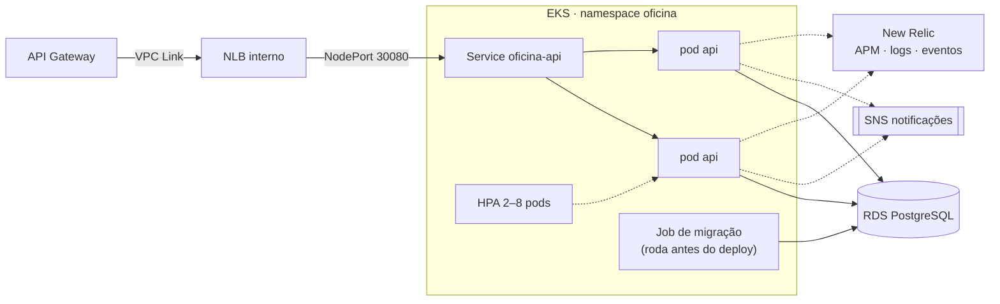

# Oficina Mecânica — API de Ordens de Serviço (Fase 3)

API .NET 8 que gerencia as **ordens de serviço da rede de oficinas**: abertura, diagnóstico, orçamento, aprovação, execução com baixa de estoque, entrega e acompanhamento pelo cliente. Na Fase 3 ela roda no **Amazon EKS**, atrás de um **API Gateway**, com autenticação **serverless** por CPF, banco **RDS PostgreSQL**, notificações por **SNS** e observabilidade no **New Relic**.

Repositório 4 de 4 do Tech Challenge da Fase 3 (SOAT):

| Repositório | Conteúdo |
| --- | --- |
| [oficina-lambda-auth](https://github.com/menta2010/oficina-lambda-auth) | Lambdas de autenticação (CPF e funcionário) e job de inativação de clientes |
| [oficina-infra-k8s](https://github.com/menta2010/oficina-infra-k8s) | VPC, EKS, API Gateway, NLB, segredos, SNS, ECR, New Relic |
| [oficina-infra-db](https://github.com/menta2010/oficina-infra-db) | RDS PostgreSQL, security groups, segredo do banco, modelo ER |
| **oficina-app** (este) | API de ordens de serviço, manifests Kubernetes, pipeline de deploy |

## Links da entrega

| Item | Link |
| --- | --- |
| API (API Gateway, homolog) | `<api_endpoint>` (output do `oficina-infra-k8s`) |
| Swagger | `<api_endpoint>/swagger` |
| Collection Postman | [docs/postman/oficina-fase3.postman_collection.json](docs/postman/oficina-fase3.postman_collection.json) |
| Arquitetura (componentes e sequência) | [docs/arquitetura.md](docs/arquitetura.md) |
| RFCs e ADRs | [docs/rfc](docs/rfc/) · [docs/adr](docs/adr/) |
| Observabilidade (dashboards e alertas) | [docs/observabilidade.md](docs/observabilidade.md) |
| Vídeo de demonstração | `<link do YouTube/Vimeo>` |

## Arquitetura deste repositório



Camadas (Clean Architecture, dependências apontando para o domínio):

| Projeto | Responsabilidade |
| --- | --- |
| `Oficina.Domain` | Entidades e regras: `OrdemServico` (máquina de estados + histórico + exclusão lógica), `Loja`, `EstoqueLoja`, `Cliente`, `Usuario` |
| `Oficina.Application` | Casos de uso, DTOs, validações e portas (`IUsuarioAtual`, `INotificadorStatusOS`, `IMetricasOrdemServico`, repositórios) |
| `Oficina.Infrastructure` | EF Core + Npgsql e migrations, repositórios, SNS, New Relic, JWT |
| `Oficina.API` | Controllers, autorização por perfil, Problem Details, correlação, Serilog JSON, health checks |

## O que mudou na Fase 3

| Tema | Mudança |
| --- | --- |
| Multiunidade | `Lojas`; OS, atendentes e estoque por loja; atendente só enxerga a própria loja |
| Autenticação | Tokens emitidos pela Lambda (`/auth/cpf` e `/auth/login`); perfis `Admin`, `Atendente` e `Cliente`; o cliente só abre e acompanha as próprias OS; `/api/acompanhamento` passou a exigir token |
| Banco | Migrations do EF Core, histórico de status, estoque por loja, `Clientes.Ativo`, chaves estrangeiras e índices ([detalhes](https://github.com/menta2010/oficina-infra-db#modelo-relacional-fase-3)) |
| Correção da Fase 2 | Exclusão lógica explícita (`Encerrada` + `incluirEncerradas`) e erros em Problem Details com `correlationId`, sem duplicação de código ([ADR-008](docs/adr/ADR-008-exclusao-logica-e-tratamento-de-erros.md)) |
| Notificação | Evento publicado no SNS a cada mudança de status ([ADR-006](docs/adr/ADR-006-notificacoes-serverless-com-sns.md)) |
| Observabilidade | Agente APM, logs JSON com correlação, eventos de negócio para os dashboards ([docs](docs/observabilidade.md)) |
| Deploy | Imagem no ECR, Job de migração, rolling update sem indisponibilidade, HPA 2–8 e PDB no EKS |
| Padronização | Domínio em português e termos técnicos em inglês ([ADR-009](docs/adr/ADR-009-convencao-de-linguagem-no-codigo.md)) |

## Tecnologias

.NET 8 · ASP.NET Core · EF Core 8 + Npgsql · PostgreSQL 16 · FluentValidation · JWT Bearer · Serilog · New Relic .NET agent · AWS SDK (SNS) · xUnit + FluentAssertions + Testcontainers · Docker (imagem chiseled, usuário não root) · Kubernetes (EKS) · GitHub Actions · Trivy · k6

## Rodando localmente

Pré-requisito: Docker. O banco sobe no Compose; as migrations e o seed rodam no startup.

```bash
docker compose up --build
```

- API: http://localhost:8080 · Swagger: http://localhost:8080/swagger
- Health: `/health/live` e `/health/ready`
- Login local (fora da nuvem): `POST /api/auth/login` com `admin` / `admin123` ou `atendente.centro` / `atendente123`

Dados do seed: lojas **Unidade Centro** e **Unidade Zona Sul**, 3 serviços, 3 peças com estoque nas duas lojas, usuários `admin` e `atendente.centro`.

Se você tem um volume de banco da Fase 2, recrie-o (o schema agora é versionado por migrations):

```bash
docker compose down -v
```

## Testes

```bash
dotnet test
```

| Projeto | Quantidade | Cobertura |
| --- | --- | --- |
| `Oficina.UnitTests` | 65 | Domínio: máquina de estados, histórico de status, exclusão lógica, estoque por loja, lojas, clientes, perfis |
| `Oficina.IntegrationTests` | 29 | API + PostgreSQL real (Testcontainers): fluxo completo da OS, webhook, escopo por perfil (atendente × loja, cliente × OS), listagem e ordenação, inativação, Problem Details e correlação |

Os testes de integração precisam do Docker em execução.

### Teste de carga (opcional)

```bash
k6 run -e API_URL=<api_endpoint> -e SENHA_ADMIN=<senha> tests/carga/k6-ordens-servico.js
kubectl -n oficina get hpa,pods -w
```

Sobe até 60 usuários virtuais por 3 minutos abrindo e listando OS. Limites: p95 da listagem < 800 ms e menos de 2% de erros. Serve para ver o HPA e o Cluster Autoscaler em ação ([ADR-002](docs/adr/ADR-002-escalabilidade-hpa-e-cluster-autoscaler.md)).

## Autenticação e perfis

| Perfil | Como obtém o token | Pode |
| --- | --- | --- |
| Cliente | `POST <api>/auth/cpf` `{"cpf": "..."}` (Lambda) | Abrir OS para si; listar e acompanhar só as próprias (`/api/acompanhamento`) |
| Atendente | `POST <api>/auth/login` `{"usuario", "senha"}` (Lambda) | Clientes, veículos e consulta de catálogo; OS e estoque **da própria loja** |
| Admin | Mesmo login | Tudo, incluindo lojas e escrita no catálogo |

No Swagger, use **Authorize** com `Bearer <token>`. O webhook de orçamento (`POST /api/ordens-servico/{id}/orcamento/resposta`) usa o header `X-Webhook-Token`.

## Endpoints principais

| Método | Rota | Perfis |
| --- | --- | --- |
| GET/POST/PUT | `/api/lojas`, `/api/lojas/{id}`, `/api/lojas/{id}/desativar` | Leitura: funcionários; escrita: admin |
| GET | `/api/lojas/{id}/estoque` | Funcionários (atendente: própria loja) |
| POST | `/api/lojas/{id}/estoque/{pecaId}/reabastecer` | Funcionários (atendente: própria loja) |
| CRUD | `/api/clientes` + `POST /{id}/inativar` e `/{id}/reativar` | Funcionários |
| CRUD | `/api/veiculos` | Funcionários |
| CRUD | `/api/servicos`, `/api/pecas-insumos` (catálogo) | Leitura: funcionários; escrita: admin |
| POST | `/api/ordens-servico` | Funcionários e cliente |
| GET | `/api/ordens-servico?status=&incluirEncerradas=&lojaId=` | Funcionários e cliente (escopo do token) |
| GET | `/api/ordens-servico/{id}` (com histórico de status) | Funcionários e cliente dono |
| POST | `/api/ordens-servico/{id}/{iniciar-diagnostico \| finalizar-diagnostico \| aprovar \| cancelar \| finalizar-execucao \| entregar}` | Funcionários |
| POST/DELETE | `/api/ordens-servico/{id}/servicos[/{itemId}[/executar]]`, `/pecas[/{itemId}[/usar]]` | Funcionários |
| GET | `/api/ordens-servico/relatorios/tempo-medio` e `/tempo-por-status` | Funcionários |
| GET | `/api/acompanhamento` e `/api/acompanhamento/{id}` | Cliente dono e funcionários |

**Listagem (`GET /api/ordens-servico`):** por padrão traz só as OS não encerradas (exclusão lógica das Finalizadas, Entregues e Canceladas), ordenadas Em execução → Aguardando aprovação → Em diagnóstico → Recebida e, no mesmo status, da mais antiga para a mais nova. Com `incluirEncerradas=true`, as encerradas vêm ao final.

**Erros:** `application/problem+json` com `status`, `title`, `detail`, `correlationId` e, em validação, `erros[]`.

## Deploy (CI/CD)

| Evento | Etapas |
| --- | --- |
| Pull Request para `develop` ou `master` | Build · 94 testes (integração com PostgreSQL real) · build da imagem · scan Trivy |
| Merge em `develop` | Tudo acima + deploy em **homolog** |
| Merge em `master` | Tudo acima + deploy em **prod** |

Etapas do deploy:

1. Descobre ECR, tópico SNS e URL do API Gateway do ambiente.
2. Build e push da imagem para o ECR (tag = commit).
3. Cria ou atualiza o Secret `oficina-api-secret` a partir do Secrets Manager (banco, JWT, webhook) e dos secrets do GitHub (New Relic, senhas do seed).
4. Aplica o ConfigMap e roda o **Job de migração** (`--migrar`), esperando a conclusão.
5. Aplica Deployment, Service, HPA e PDB e espera o rollout.
6. **Smoke test ponta a ponta** pelo API Gateway: `/health/ready` → login na Lambda → `GET /api/lojas` com o token.

| Arquivo | Recurso |
| --- | --- |
| `k8s/00-namespace.yaml` | Namespace `oficina` |
| `k8s/01-configmap.yaml` | Configuração não sensível + agente New Relic |
| `k8s/02-migracao-job.yaml` | Job de migrations e seed |
| `k8s/03-deployment.yaml` | API: 2 réplicas, rolling update sem indisponibilidade, probes, requests/limits, espalhamento por zona |
| `k8s/04-service.yaml` | NodePort 30080 (alvo do NLB interno) |
| `k8s/05-hpa.yaml` | HPA (CPU 70%, memória 80%, 2–8 pods) e PodDisruptionBudget |

### Configuração no GitHub (uma vez)

1. Environments `homolog` e `prod`:
   - Secrets: `AWS_ACCESS_KEY_ID`, `AWS_SECRET_ACCESS_KEY`, `AWS_SESSION_TOKEN` (AWS Academy), `NEW_RELIC_LICENSE_KEY`, `SEED_ADMIN_PASSWORD` e `SEED_ATENDENTE_PASSWORD`.
   - Variable: `AWS_REGION` (padrão `us-east-1`).
2. Proteção das branches `master` e `develop`: Pull Request obrigatório, checks `Build & Test` e `Docker image + Trivy` obrigatórios, push direto bloqueado.
3. Colaborador `soat-architecture` com acesso de leitura.

## Histórico

As entregas anteriores (DDD e Event Storming da Fase 1; Clean Architecture, Kubernetes local e Terraform da Fase 2) continuam no histórico do Git e em `docs/` (relatórios de qualidade e segurança, documentação técnica).
