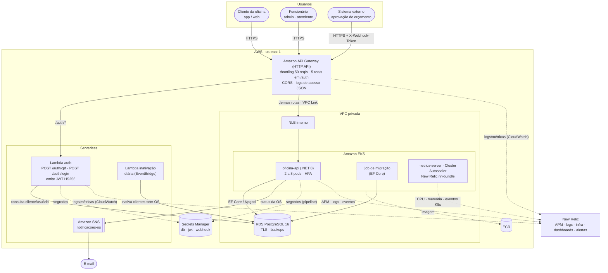
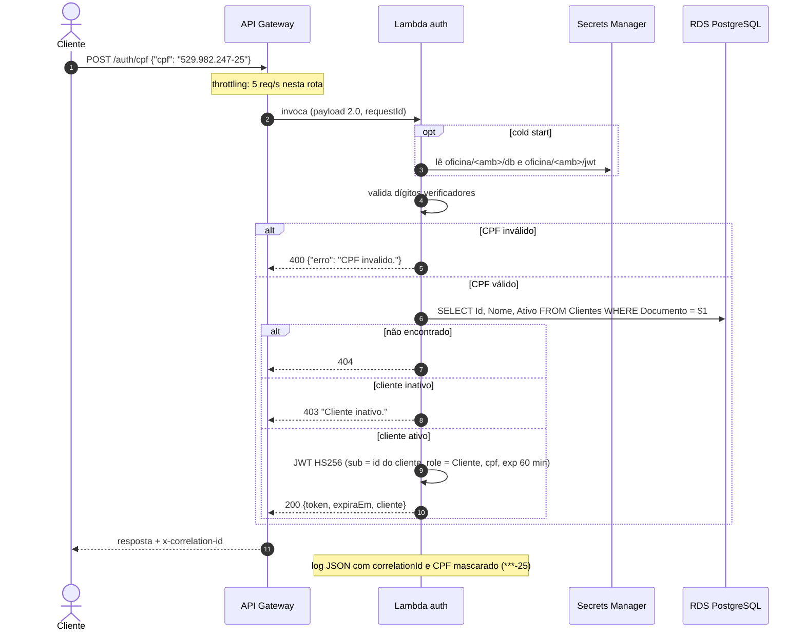
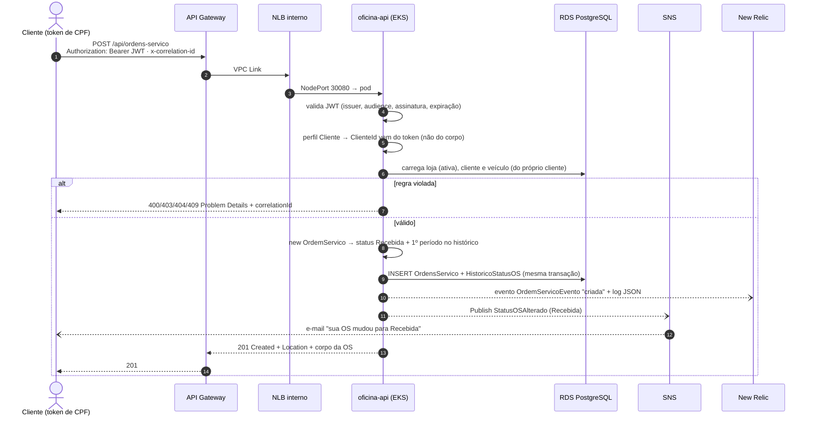

# Arquitetura da solução — Fase 3

A oficina passou a operar como uma **rede de unidades** e a aplicação saiu de um cluster local para a **AWS**. Toda chamada entra pelo **API Gateway**: a autenticação é **serverless** (Lambda) e a API de ordens de serviço roda no **EKS**, com banco **RDS PostgreSQL**, notificações por **SNS** e observabilidade no **New Relic**.

| Documento | Conteúdo |
| --- | --- |
| Este arquivo | Diagrama de componentes e diagramas de sequência |
| [RFCs](rfc/) | Propostas técnicas discutidas pelo grupo: nuvem, banco e autenticação |
| [ADRs](adr/) | Decisões arquiteturais permanentes |
| [Observabilidade](observabilidade.md) | Logs, métricas, traces, dashboards (NRQL) e alertas |
| [Modelo de dados](https://github.com/menta2010/oficina-infra-db#modelo-relacional-fase-3) | Diagrama ER, justificativa do PostgreSQL e índices |

## Repositórios

| Repositório | Conteúdo | Deploy |
| --- | --- | --- |
| [oficina-infra-k8s](https://github.com/menta2010/oficina-infra-k8s) | VPC, EKS, NLB, API Gateway, segredos, SNS, ECR, New Relic | Terraform |
| [oficina-infra-db](https://github.com/menta2010/oficina-infra-db) | RDS PostgreSQL, security groups, segredo do banco | Terraform |
| [oficina-lambda-auth](https://github.com/menta2010/oficina-lambda-auth) | Lambdas de autenticação (CPF e funcionário) e job de inativação | .NET 8 + Terraform |
| [oficina-app](https://github.com/menta2010/tech-challenge-oficina-mecanica) (este) | API de ordens de serviço | Docker → ECR → EKS |

Todos usam GitHub Actions com `develop` → **homolog** e `main` → **prod**, branches protegidas e merge só por Pull Request.

## Diagrama de componentes

**Leitura:** o cliente só enxerga o API Gateway. As rotas `/auth/*` vão para a Lambda; o resto atravessa o VPC Link até o NLB interno e os pods da API. Banco, NLB e nós ficam em subnets privadas. Os dois emissores de tráfego para o New Relic são o agente APM nos pods e a integração Kubernetes; Lambda, API Gateway e RDS chegam pelo CloudWatch.

## Sequência 1 — Autenticação por CPF

## Sequência 2 — Abertura de ordem de serviço

A partir daí, cada transição feita por um funcionário (diagnóstico, orçamento, execução, finalização, entrega) fecha o período do status anterior, registra a duração no New Relic e publica a notificação. Esses eventos alimentam os dashboards de tempo médio por status.
